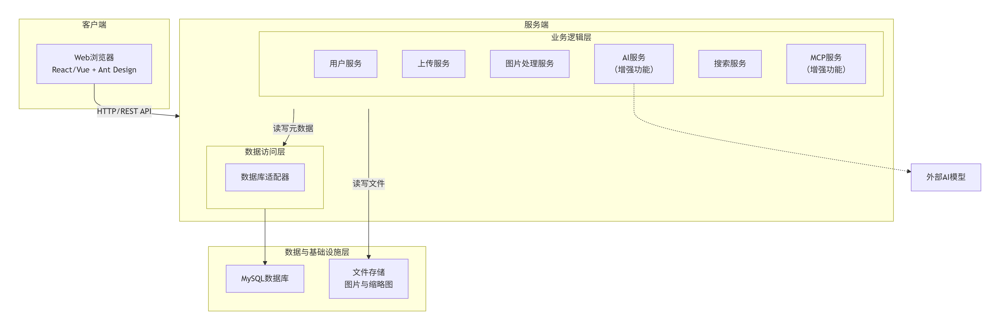
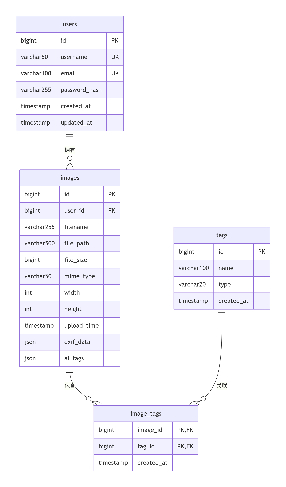

# 《BS 体系软件设计》大程设计文档

**姓名：李禹衡**  
**学号：3230105685**  
**专业：计算机科学与技术**  

**2025年11月21日**
> 设计文档中代码实现部分仅作为设计构想，后续代码开发时可能有出入
---

## 项目名称：智能图片管理网站

## 1. 项目概述

### 1.1 项目背景
本项目旨在开发一个基于B/S架构的智能图片管理网站，为用户提供便捷的图片上传、分类、检索和管理服务。

### 1.2 项目目标
1. 需要实现的**基本功能**如下：
   1. 实现用户注册、登录功能，用户注册时需要填写必要的信息并验证，如用户名、密码要求在 6 字节以上，email 的格式验证，并保证用户名和 email 在系统中唯一，用户登录后可以进行以下操作。
   2. 通过 PC 或手机浏览器将照片或其他类型的图片上传到网站进行存储。
   3. 能够通过照片的 exif 信息自动创建图片分类标签及其他辅助信息，如时间、地点、图片分辨率等。
   4. 可以给图片增加自定义分类标签，方便检索。
   5. 生产缩略图方便后续显示。
   6. 图片信息保存在数据库中，方便后续查询。
   7. 提供查询界面能根据各种条件查找图片。
   8. 提供友好的展示界面，如选择一定的图片进行轮播显示等
   9. 对选定的图片提供简单的编辑功能，如裁剪、修改色调等
   10. 提供删除功能
   11. 样式适配手机，开发手机 App 或能够在手机浏览器/微信等应用内置的浏览器中友好显示。
2. **增强功能**（根据后续项目开发进度选择实现）：
   1. 调用 AI 模型分析图片，提供多类型的标签，如风景、人物、动物等
   2. 提供 mcp 接口，能通过大模型对话方式检索网站上的图片。

<!-- ### 1.3 技术选型 -->

### 1.3 技术栈选型
| 层级 | 技术方案 | 功能 |
|------|----------|------|
| 前端 | React 18 + Ant Design Mobile | 支持响应式设计，适配移动端 |
| 后端 | Spring Boot 3.x + Java 17 | 提供RESTful API接口 |
| 数据库 | MySQL 8.0 | 主数据库，存储结构化数据 |
| 文件存储 | 本地文件系统 | 存储图片文件 |
| 图片处理 | Thumbnailator + metadata-extractor | 缩略图生成和EXIF信息提取 |
| AI服务 | OpenAI CLIP模型 | 图片智能标签生成 |
| 容器化 | Docker + Docker Compose | 应用部署和运行环境 |
| 版本控制 | Git | 代码管理 |

## 2. 系统架构设计

### 2.1 整体架构

整个系统分成四层，如下图：



### 2.2 各部分说明

#### 2.2.1 前端架构
- **组件化开发**：基于React函数组件和Hooks
- **状态管理**：使用Redux Toolkit进行状态管理
- **路由管理**：React Router实现SPA路由
- **UI框架**：Ant Design Mobile提供基础组件库
- **响应式适配**：CSS Media Query配合Flex布局

#### 2.2.2 后端架构
- **分层架构**：Controller-Service-DAO标准分层
- **RESTful API**：统一的API设计和响应格式
- **安全机制**：JWT令牌认证，BCrypt密码加密
- **异常处理**：全局异常处理机制
- **文件处理**：异步文件上传和处理

## 3. 功能模块设计

### 3.1 用户管理

#### 3.1.1 功能说明
处理用户注册、登录、退出，用JWT保持登录状态。

#### 3.1.2 主要接口
```java
// 注册
POST /api/auth/register
{
    "username": "string",  // 用户名，6字符以上
    "password": "string",  // 密码，6字符以上
    "email": "string"      // 邮箱
}

// 登录
POST /api/auth/login
{
    "username": "string",
    "password": "string"
}
返回：{
    "token": "string",     // 登录令牌
    "userInfo": {...}      // 用户信息
}
```

#### 3.1.3 验证规则
- 用户名：6-20字符，字母数字下划线，不能重复
- 密码：6字符以上，含字母和数字
- 邮箱：标准邮箱格式，不能重复

### 3.2 图片上传

#### 3.2.1 功能说明
支持多格式图片上传，包括JPEG、PNG、GIF、WEBP等格式，提供拖拽上传和传统文件选择两种方式。

#### 3.2.2 主要接口
```java
// 上传图片
POST /api/images/upload
Content-Type: multipart/form-data
{
    "file": "文件对象",
    "customTags": ["标签1", "标签2"]  // 自定义标签
}
返回：{
    "imageId": "图片ID",
    "filename": "文件名", 
    "uploadTime": "上传时间"
}
```

#### 3.2.3 实现方式
- 前端用axios上传，显示进度条
- 后端用Spring接收文件
- 限制：单文件最大20MB，只支持图片格式
- 存储：按用户ID分文件夹存放

### 3.3 图片处理

#### 3.3.1 读取EXIF信息
计划设计`ExifExtractor`类如下：
```java
public class ExifExtractor {
    public ImageMetadata getExifInfo(File image) {
        // 读取拍摄时间、相机信息、GPS位置等
        return 元数据对象;
    }
}
```

#### 3.3.2 生成缩略图
计划设计`ThumbnailGenerator`类如下：
```java
public class ThumbnailGenerator {
    public void makeThumbnails(File original) {
        makeThumb(original, 300, 300);   // 小图，用于列表
        makeThumb(original, 600, 600);   // 中图，用于预览  
        makeThumb(original, 1200, 1200); // 大图，用于查看
    }
}
```

### 3.4 智能标签（扩展功能）
#### 3.4.1 自动打标签
计划设计`AutoTagService`类如下：
```java
public class AutoTagService {
    public List<String> getAutoTags(File image) {
        // 调用图像识别API分析图片内容
        return Arrays.asList("风景", "建筑", "白天");
    }
}
```

#### 3.4.2 标签优先级
- 用户手动加的标签最重要
- AI自动识别的标签其次
- EXIF信息转换的标签作为补充

### 3.5 图片搜索

#### 3.5.1 条件搜索
```java
// 搜索图片
GET /api/images/search
参数：{
    "keyword": "关键词",     // 模糊匹配
    "tags": ["标签1"],       // 按标签筛选
    "startDate": "开始时间",  // 时间范围
    "endDate": "结束时间",
    "page": "页码",          // 分页
    "size": "每页数量"
}
```

#### 3.5.2 智能搜索（扩展功能）
```java
// 自然语言搜索
POST /api/mcp/search
{
    "query": "找出上周拍的风景照片"  // 直接语言搜索
}
返回：{
    "images": ["图片列表"],
    "explanation": "搜索说明" 
}
```

### 3.6 图片展示和编辑

#### 3.6.1 轮播展示
- 用户可以选图片创建轮播集
- 支持自动播放和手动切换

#### 3.6.2 图片编辑
```java
// 编辑图片
POST /api/images/{id}/edit
{
    "operations": [
        {
            "type": "CROP",      // 裁剪
            "params": {"x": 10, "y": 10, "width": 100, "height": 100}
        },
        {
            "type": "FILTER",    // 滤镜
            "params": {"type": "brightness", "value": 1.2}
        }
    ]
}
```

## 4. 数据库设计

### 4.1 数据库表关系

主要表之间的关系如下：

<!-- ```mermaid
erDiagram
    users ||--o{ images : "拥有"
    users {
        bigint id PK
        varchar50 username UK
        varchar100 email UK
        varchar255 password_hash
        timestamp created_at
        timestamp updated_at
    }
    
    images ||--o{ image_tags : "包含"
    images {
        bigint id PK
        bigint user_id FK
        varchar255 filename
        varchar500 file_path
        bigint file_size
        varchar50 mime_type
        int width
        int height
        timestamp upload_time
        json exif_data
        json ai_tags
    }
    
    tags ||--o{ image_tags : "关联"
    tags {
        bigint id PK
        varchar100 name
        varchar20 type
        timestamp created_at
    }
    
    image_tags {
        bigint image_id PK,FK
        bigint tag_id PK,FK
        timestamp created_at
    }
``` -->

### 4.2 具体表结构

#### 4.2.1 用户表
```sql
CREATE TABLE users (
    id BIGINT AUTO_INCREMENT PRIMARY KEY,
    username VARCHAR(50) UNIQUE NOT NULL,
    email VARCHAR(100) UNIQUE NOT NULL,
    password_hash VARCHAR(255) NOT NULL,
    created_at TIMESTAMP DEFAULT CURRENT_TIMESTAMP,
    updated_at TIMESTAMP DEFAULT CURRENT_TIMESTAMP ON UPDATE CURRENT_TIMESTAMP,
    INDEX idx_username (username),
    INDEX idx_email (email)
);
```

#### 4.2.2 图片表
```sql
CREATE TABLE images (
    id BIGINT AUTO_INCREMENT PRIMARY KEY,
    user_id BIGINT NOT NULL,
    filename VARCHAR(255) NOT NULL,
    file_path VARCHAR(500) NOT NULL,
    file_size BIGINT NOT NULL,
    mime_type VARCHAR(50) NOT NULL,
    width INT,
    height INT,
    upload_time TIMESTAMP DEFAULT CURRENT_TIMESTAMP,
    exif_data JSON,
    ai_tags JSON,
    FOREIGN KEY (user_id) REFERENCES users(id) ON DELETE CASCADE,
    INDEX idx_user_id (user_id),
    INDEX idx_upload_time (upload_time)
);
```

#### 4.2.3 标签表
```sql
CREATE TABLE tags (
    id BIGINT AUTO_INCREMENT PRIMARY KEY,
    name VARCHAR(100) NOT NULL,
    type ENUM('EXIF', 'AI', 'CUSTOM') NOT NULL,
    created_at TIMESTAMP DEFAULT CURRENT_TIMESTAMP,
    INDEX idx_name (name),
    INDEX idx_type (type)
);
```

#### 4.2.4 图片标签关联表
```sql
CREATE TABLE image_tags (
    image_id BIGINT NOT NULL,
    tag_id BIGINT NOT NULL,
    created_at TIMESTAMP DEFAULT CURRENT_TIMESTAMP,
    PRIMARY KEY (image_id, tag_id),
    FOREIGN KEY (image_id) REFERENCES images(id) ON DELETE CASCADE,
    FOREIGN KEY (tag_id) REFERENCES tags(id) ON DELETE CASCADE,
    INDEX idx_tag_id (tag_id)
);
```

## 5. 接口设计

### 5.1 用户相关接口

| 方法 | 路径 | 说明 | 需要登录 | 参数 | 返回 |
|------|------|------|----------|------|------|
| POST | `/api/auth/register` | 注册 | 不用 | 用户名密码邮箱 | token和用户信息 |
| POST | `/api/auth/login` | 登录 | 不用 | 用户名密码 | token和用户信息 |
| POST | `/api/auth/logout` | 退出 | 要 | 无 | 成功状态 |

### 5.2 图片相关接口

| 方法 | 路径 | 说明 | 需要登录 | 参数 | 返回 |
|------|------|------|----------|------|------|
| POST | `/api/images/upload` | 上传 | 要 | 文件和标签 | 图片信息 |
| GET | `/api/images` | 列表 | 要 | 无 | 图片列表 |
| GET | `/api/images/{id}` | 详情 | 要 | 无 | 图片详情 |
| PUT | `/api/images/{id}` | 更新 | 要 | 标题描述标签 | 成功状态 |
| DELETE | `/api/images/{id}` | 删除 | 要 | 无 | 成功状态 |
| GET | `/api/images/search` | 搜索 | 要 | 搜索条件 | 搜索结果 |

### 5.3 标签相关接口

| 方法 | 路径 | 说明 | 需要登录 | 参数 | 返回 |
|------|------|------|----------|------|------|
| GET | `/api/tags` | 标签列表 | 要 | 无 | 所有标签 |
| POST | `/api/tags` | 创建标签 | 要 | 标签名和类型 | 新标签 |
| DELETE | `/api/tags/{id}` | 删除标签 | 要 | 无 | 成功状态 |

## 6. 部署方案

### 6.1 Docker部署

#### 6.1.1 Dockerfile
```dockerfile
FROM openjdk:17-jdk-slim

WORKDIR /app

# 复制打包好的应用
COPY target/image-manager-0.0.1-SNAPSHOT.jar app.jar

# 创建存图片的文件夹
RUN mkdir -p /app/uploads

EXPOSE 8080

# 启动命令
ENTRYPOINT ["java", "-jar", "/app.jar"]
```

#### 6.1.2 docker-compose.yml
```yaml
version: '3.8'

services:
  app:
    build: .
    ports:
      - "8080:8080"
    environment:
      - SPRING_DATASOURCE_URL=jdbc:mysql://mysql:3306/image_db
      - SPRING_DATASOURCE_USERNAME=root
      - SPRING_DATASOURCE_PASSWORD=password
      - SPRING_SERVLET_MULTIPART_MAX-FILE-SIZE=20MB
    depends_on:
      - mysql
    volumes:
      - ./uploads:/app/uploads
    restart: unless-stopped

  mysql:
    image: mysql:8.0
    environment:
      MYSQL_ROOT_PASSWORD: password
      MYSQL_DATABASE: image_db
    volumes:
      - mysql_data:/var/lib/mysql
      - ./init.sql:/docker-entrypoint-initdb.d/init.sql
    restart: unless-stopped

volumes:
  mysql_data:
```

### 6.2 数据库初始化
```sql
-- 创建数据库
CREATE DATABASE IF NOT EXISTS image_db;
USE image_db;

-- 建表语句（即前文4.2节的表）
-- 这里实际放创建users、images、tags、image_tags表的SQL
```

## 7. 测试计划

<!-- ### 7.1 测试内容

#### 7.1.1 单元测试
- **工具**：JUnit 5
- **重点**：核心业务逻辑、工具类
- **目标**：保证主要功能正确

#### 7.1.2 接口测试
- **工具**：Postman或RestAssured
- **重点**：API接口是否正常工作
- **目标**：前后端能正常对接

#### 7.1.3 功能测试
- **内容**：主要业务流程
- **重点**：上传、搜索、编辑图片
- **目标**：用户能顺利完成操作

### 7.2 重点测试项 -->

1. **用户系统**
   - 注册登录流程
   - 密码加密
   - 登录状态保持

2. **图片功能**
   - 上传各种格式图片
   - 生成缩略图
   - EXIF信息读取

3. **搜索性能**
   - 多条件搜索
   - 大量图片时的搜索速度

4. **手机使用**
   - 不同手机浏览器显示
   - 触摸操作是否顺畅

<!-- --- -->
<!-- 
*文档版本：v2.1*  
*最后更新：2025年11月21日* -->